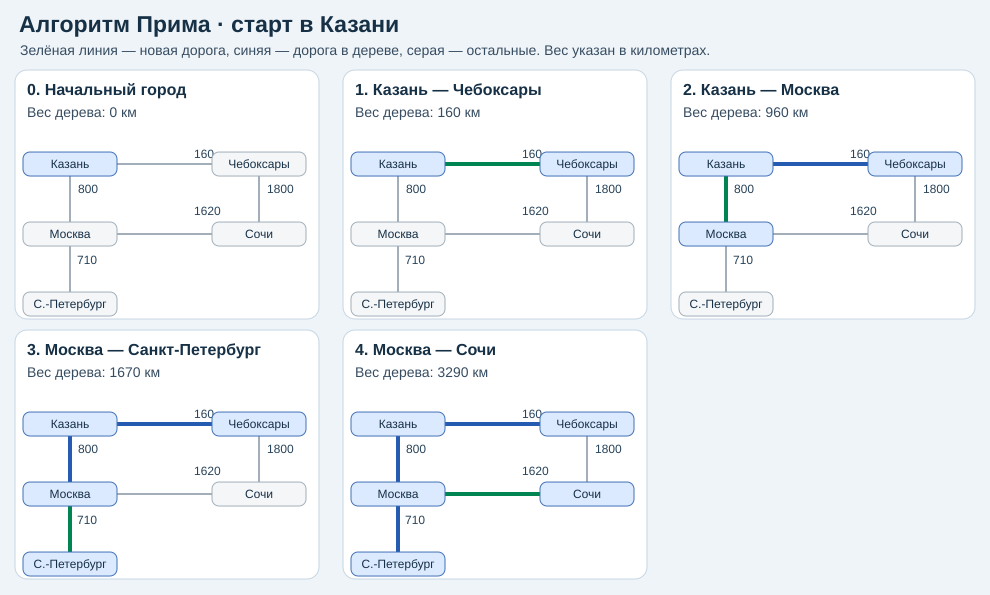

# Алгоритм Прима

Практическая работа для 3П3. В коде использован тот же неориентированный граф из пяти городов и те же учебные расстояния, что и в работе по алгоритму Краскала.

Чтобы запустить программу, откройте `CityMst.csproj` в Visual Studio и нажмите **Ctrl+F5** или выполните `dotnet run` в папке проекта с .NET 10 SDK. В `Prim.cs` находится алгоритм, в `Program.cs` — исходный граф и вывод шагов.

## Построение дерева

Начинаем с Казани. На каждом шаге ищем самую короткую дорогу, у которой ровно один конец уже входит в дерево. Добавляем эту дорогу вместе с новым городом. По свойству разреза такое ребро можно включить в минимальный остов, а присоединение нового города сохраняет дерево без циклов.

| Шаг | Кандидаты, км | Выбранная дорога | Вес, км | Сумма, км |
| ---: | :--- | :--- | ---: | ---: |
| 1 | 160, 800 | Казань — Чебоксары | 160 | 160 |
| 2 | 800, 1800 | Казань — Москва | 800 | 960 |
| 3 | 710, 1620, 1800 | Москва — Санкт-Петербург | 710 | 1670 |
| 4 | 1620, 1800 | Москва — Сочи | 1620 | 3290 |

После четвёртого шага все пять городов в дереве. Дорога Чебоксары — Сочи длиной 1800 км осталась за пределами остова.

## Сравнение с прошлой КТ

Оба алгоритма выбрали одни и те же **4 дороги общей длиной 3290 км**. Порядок отличается. Прим выбрал веса 160 → 800 → 710 → 1620 км, а Краскал — 160 → 710 → 800 → 1620 км. Для Прима дорога Москва — Санкт-Петербург становится кандидатом после присоединения Москвы.

## Сложность

Для `V` вершин и `E` рёбер алгоритм до `V − 1` раз просматривает список дорог. Время построения остова — **O(V + VE)**, или **O(VE)** для связного графа с хотя бы одним ребром. Дополнительная память алгоритма — **O(V)** для отметок городов. Демонстрационный вывод списка подключённых городов требует до **O(V²)** времени без учёта длины названий.
